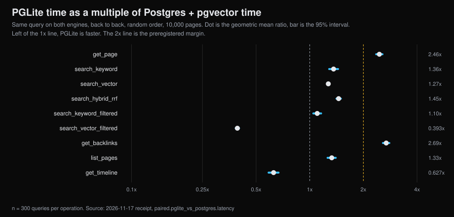
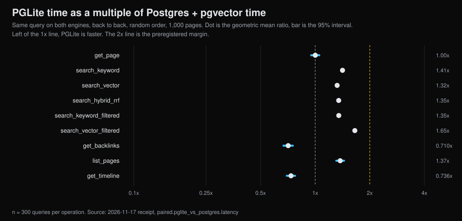
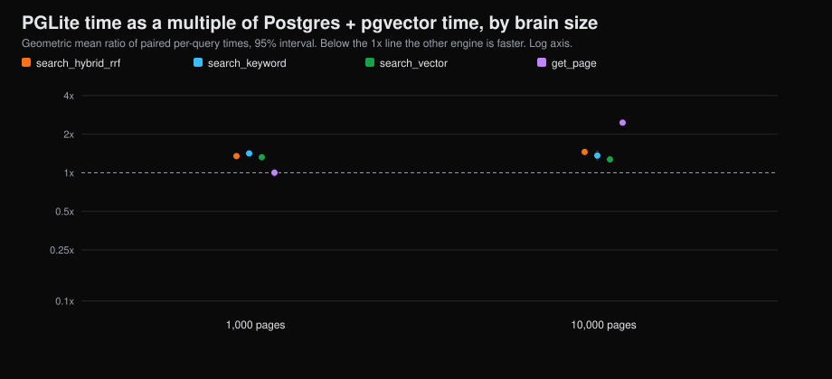

# PGLite or Postgres: which engine should a gbrain of 1,000 or 10,000 pages use?

gbrain is Garry Tan's own project. Preregistered in [the preregistration](2026-11-16-engine-shootout-preregistration.md) before the first counted run. Measured on gbrain v0.60.734.0 (`a278ddf45`).

## What we learned

- We learned that PGLite answers a hybrid search in 1.35 times the time of a Postgres server with pgvector at 1,000 pages (95% interval 1.33 to 1.36) and 1.45 times at 10,000 pages (1.41 to 1.50), which is inside the preregistered 2x margin at both sizes, with a 95th percentile of 16.3 ms and 86.8 ms. You should start a single-user brain on PGLite, which needs no server, and not move to Postgres for search speed alone at these sizes.
- We learned that PGLite loses on page reads once the brain is large: `get_page` takes 2.46 times as long at 10,000 pages (2.36 to 2.56) and backlinks 2.69 times (2.58 to 2.80), where at 1,000 pages the page read was the same speed. You should pick Postgres for a brain of this size if you read pages and backlinks more than you search, and when you need a second process on the same brain, which this experiment does not test.
- We learned that PGLite also costs more to run per search, by this experiment's price model: $4.73e-4 against $2.66e-4 per 1,000 hybrid searches at 10,000 pages, and it holds about 2.1 GB of memory against about 0.5 GB for Postgres, at both sizes. You should budget memory for PGLite as a fixed 2 GB or so, not as something that grows with the brain.

The engines returned the same pages in the same order for every one of the 71 quality queries at both sizes, so these are speed and cost differences between engines with identical answers.

This is a PGLite versus Postgres baseline only. It does not say whether PGLite can be deprecated in favor of the Rust engine: the Rust engine is not in it, and neither is concurrent access.

## The case

A user installs gbrain, keeps notes in it, and asks which database to point it at. PGLite is Postgres compiled to WebAssembly and run inside the gbrain process, with its data in a folder. Postgres with pgvector is a server the user runs. We built brains of 1,000 and 10,000 pages from the committed `world-v1` corpus (240 pages) plus generated filler, loaded each into both engines through gbrain's own engine code, and sent the same queries to both.

## Experiment and results

Design, in short (all of it, and the decision rule, is in the [preregistration](2026-11-16-engine-shootout-preregistration.md)):

- One machine (8 logical CPUs, Intel Xeon 6975P-C, 30 GB), run alone, one counted run per size. Postgres is `pgvector/pgvector:pg16` (digest `sha256:484e8380...e579f`, PostgreSQL 16.16) in a local container with stock settings. Both engines use gbrain's schema and search methods, and the same vectors.
- Latency: 300 queries per operation after a warm-up. Each query goes to both engines back to back, in a random order, so the engines see the same input, the same moment and the same cache state. The interval is a paired bootstrap over the 300 queries (10,000 draws, seed 1337). Ratios are the geometric mean of per-query PGLite time over Postgres time. The [charts](#charts) and tables come from the receipts.
- Cost: 20 blocks of 50 identical operations per operation, both engines per block, random order. CPU seconds and memory held, priced with AWS Fargate list prices as of 2026-11-16. This is a price assumption, not a quote.
- Quality: Recall@5 and nDCG@10 on 71 Tier 5 and Tier 5.5 queries, binary relevance by page.

### Paired latency, PGLite over Postgres

The ratio is PGLite time divided by Postgres time. Above 1 means PGLite is slower. Interval is 95%.

| Operation | 1,000 pages ratio (interval) | 10,000 pages ratio (interval) |
|---|---:|---:|
| `search_hybrid_rrf` (primary) | 1.35 (1.33 to 1.36) | 1.45 (1.41 to 1.50) |
| `search_keyword` | 1.41 (1.39 to 1.44) | 1.36 (1.29 to 1.44) |
| `search_vector` | 1.32 (1.30 to 1.34) | 1.27 (1.26 to 1.28) |
| `search_keyword_filtered` | 1.35 (1.34 to 1.36) | 1.10 (1.05 to 1.16) |
| `search_vector_filtered` | 1.65 (1.64 to 1.67) | 0.393 (0.384 to 0.401) |
| `get_page` | 1.00 (0.951 to 1.05) | 2.46 (2.36 to 2.56) |
| `get_backlinks` | 0.710 (0.669 to 0.753) | 2.69 (2.58 to 2.80) |
| `get_timeline` | 0.736 (0.698 to 0.774) | 0.627 (0.588 to 0.668) |
| `list_pages` | 1.37 (1.31 to 1.44) | 1.33 (1.26 to 1.40) |

Hybrid search in milliseconds, 300 queries (p50 / p95 / p99):

| | Postgres | PGLite |
|---|---:|---:|
| 1,000 pages | 9.96 / 11.8 / 12.6 | 13.1 / 16.3 / 19.5 |
| 10,000 pages | 16.0 / 39.5 / 47.7 | 21.3 / 86.8 / 142 |

Preregistered outcome at both sizes, applied by code: `pglite_adequate` (interval upper bound at most 2.0 and PGLite p95 at most 100 ms). At 10,000 pages the margin to the 100 ms limit is thin: p95 is 86.8 ms and p99 is 142 ms. The 2x margin and the 100 ms limit are product assumptions we chose before the runs, not findings.

Where each engine loses, from the same receipts:

- PGLite is slower on keyword, vector and hybrid search at both sizes (about 1.3 to 1.5 times), and on page reads and backlinks at 10,000 pages (about 2.5 times). It is slower to start (885 ms against 507 ms at 10,000 pages, median of 5, warm file cache) and to import (29.8 pages per second against 63.7 at 10,000 pages).
- Postgres is slower on filtered vector search at 10,000 pages: 51.4 ms against 20.5 ms at the median, so PGLite takes 0.393 times as long. We did not look into why, and we do not claim a cause. It is a result for the default settings and the default index, on this data. Postgres is also slower on small point reads at 1,000 pages: backlinks (PGLite 0.710 times, 0.669 to 0.753) and timeline (0.736 times, 0.698 to 0.774), by fractions of a millisecond.
- The ordering check shows the same direction and about the same size whichever engine ran first, for every operation except `get_page` at 1,000 pages, where the sign flips within 0.2 ms (0.033 ms against -0.143 ms). The table is in `summary.md`.

### Cost per 1,000 operations

Difference is PGLite minus Postgres, in dollars per 1,000 operations, with a 95% interval over 20 blocks. These intervals are wide next to the latency ones, and cost was secondary.

| Operation | Size | Postgres | PGLite | Difference (interval) |
|---|---|---:|---:|---:|
| `search_hybrid_rrf` | 1,000 | $1.20e-4 | $1.87e-4 | $6.73e-5 ($6.03e-5 to $7.41e-5) |
| `search_hybrid_rrf` | 10,000 | $2.66e-4 | $4.73e-4 | $2.07e-4 ($1.78e-4 to $2.39e-4) |
| `get_page` | 1,000 | $4.70e-6 | $4.67e-6 | -$2.15e-8 (-$1.39e-6 to $9.40e-7) |
| `get_page` | 10,000 | $1.29e-5 | $4.95e-5 | $3.66e-5 ($3.60e-5 to $3.73e-5) |

These are fractions of a cent. At these prices the money is not the reason to choose. The same price model lists a small hosted Postgres (Amazon RDS db.t4g.medium) at about $47.45 a month whatever the query volume, and that monthly line equals the query cost of about 100 million PGLite hybrid searches at 10,000 pages. Cost for keyword and vector search is in `summary.md`.

### Quality

Identical at both sizes. Every Recall@5 and nDCG@10 difference is exactly 0 with 0 queries that differ, for keyword, vector and hybrid. Absolute scores are low and fall as filler pages are added (hybrid Recall@5 0.265 at 1,000 pages, 0.092 at 10,000), because the vectors are hash embeddings, which measure word overlap and not meaning, and because 85.9% of keyword searches return no result for either engine (the natural-language queries do not match all their words in any page). Hash embeddings are a control. These numbers show that the engines agree with each other. They do not show how well gbrain retrieves with a real embedding model.

### Memory, disk, import and cold start

One run per engine, no interval, and no decision rides on these.

| Measure | 1,000 Postgres | 1,000 PGLite | 10,000 Postgres | 10,000 PGLite |
|---|---:|---:|---:|---:|
| Peak memory, engine plus server (MB) | 253 | 2,146 | 484 | 2,188 |
| On-disk size without WAL (MB) | 86.3 | 85.9 | 411 | 429 |
| Bulk import (pages per second) | 67.5 | 52.1 | 63.7 | 29.8 |
| Cold start to first answer (ms, median of 5) | 457 | 801 | 507 | 885 |

PGLite's memory is its WebAssembly heap in the gbrain process, measured as peak resident memory minus the harness's own baseline. It was about the same at both sizes, so treat it as a fixed cost near 2 GB. Postgres is the container's working set (the `docker stats` definition) plus its client.

## What to use and avoid

- Use PGLite for a brain up to 10,000 pages when one process is the only reader and you want no server. Search is about 1.3 to 1.5 times slower than Postgres, and hybrid p95 stays under 100 ms in this run.
- Use Postgres with pgvector when you read pages and backlinks a lot at 10,000 pages, when you need several processes on one brain, when memory is tight (PGLite holds about 2 GB), or when you import often (PGLite imported at about half the rate at 10,000 pages).
- Avoid reading the 100 ms p95 limit as a guarantee for a bigger brain. PGLite's p95 went from 16.3 to 86.8 ms between the two sizes, and p99 reached 142 ms.
- Avoid reading these numbers as the answer to whether PGLite can be removed. Concurrency, a hosted server and the Rust engine are not measured.

## What was not measured

- The Rust engine. It stays a documented hook (`ENGINES` in `eval/runner/engine-shootout.ts`) and will be its own preregistered experiment after it passes search parity.
- Concurrent clients, more than one process on one brain, and writes while searching.
- Real embedding models. All vectors are hash embeddings at 1,024 dimensions, to match gbrain's default column.
- A cold operating-system cache. Cold start has a warm file cache, because dropping caches needs root.
- A hosted Postgres service. Postgres here is a local container with stock settings and no tuning, on the same machine as the client.
- Sizes other than 1,000 and 10,000 pages, and any trend between them. The two sizes are shown side by side with no test of a trend.

## Deviations and caveats

- gbrain's own chunker and embedding pipeline are not used. The harness chunks pages with its own simple chunker and embeds with `hash-embed-v1`, writes through `putPage` and `upsertChunks`, and then calls gbrain's `sealPageTextProjection`, because at this gbrain version a page is returned by search only after that seal. The seal time is in the import throughput.
- Hybrid search is an engine-level reciprocal rank fusion (k = 60) of the keyword and vector lists, not gbrain's full `hybridSearch`.
- Filler pages are built from `synthetic-v1` and `source-swamp-v1` paragraphs only, so they cannot compete with the relevant pages of the 71 queries.
- Disk is `du -sb` of the data directory after 100 page updates and a checkpoint.
- Two earlier launches of the counted command failed before writing any receipt, at both sizes, in the cost-block phase: an index ran past the end of a per-query slug list. We fixed the runner in a [commit on the preregistration branch](../../eval/runner/engine-shootout.ts) (a modulo on the index) and ran again. The fix touches only which query a cost block uses. Both failed launches are invalid runs under the preregistration's stop rules, and the two receipts here are the first valid ones for each size.
- The preregistration was written after a 300-page development run of the same runner, which is why it is classed as development evidence.
- Results are from one machine and one run per size. Intervals cover variation across queries, not variation across runs or machines.

## Reproduce and inspect

From the repository root, with Docker running and `bun install` done:

```
bun eval/runner/engine-shootout.ts --scale 1000 --cold-reps 5 --out docs/benchmarks/2026-11-16-engine-shootout/results
bun eval/runner/engine-shootout.ts --scale 10000 --cold-reps 5 --out docs/benchmarks/2026-11-16-engine-shootout/results
bun eval/runner/engine-shootout-chart.ts docs/benchmarks/2026-11-16-engine-shootout/results/*.json --out docs/benchmarks/2026-11-16-engine-shootout
```

The 1,000-page run took 180 seconds and the 10,000-page run 822 seconds. A counted run refuses to start unless the preregistration is committed, unchanged and on an origin branch, and the receipt records that attestation. `bun run eval:engine-shootout -- --dev --scale 300` is a quick check that does not count.

Receipts, one per size, with every per-query row under `paired.pglite_vs_postgres.rows`:

- [results/2026-11-17T03-22-10-1000.json](2026-11-16-engine-shootout/results/2026-11-17T03-22-10-1000.json)
- [results/2026-11-17T03-35-52-10000.json](2026-11-16-engine-shootout/results/2026-11-17T03-35-52-10000.json)
- [summary.md](2026-11-16-engine-shootout/summary.md), every table behind the charts, generated by the chart command above.

### Charts







Also in the folder: `latency-*.svg` (p50 and p95 per engine), `cost-*.svg`, `footprint-*.svg` and `quality-*.svg`, one per size.

### Where each number comes from

Every figure above is in `summary.md` and in the receipt. In a receipt, with `<size>` the 1,000 or 10,000 file:

| Figure | Path in the receipt |
|---|---|
| Ratio and interval | `paired.pglite_vs_postgres.latency.<operation>.geo_mean_ratio` |
| p50, p95 and p99 | `paired.pglite_vs_postgres.latency.<operation>.{ref,other}_p{50,95,99}_ms` (ref is Postgres, other is PGLite) |
| Order check | `paired.pglite_vs_postgres.latency.<operation>.by_order` |
| Cost per 1,000 operations | `paired.pglite_vs_postgres.cost_per_op.<operation>` |
| Quality | `paired.pglite_vs_postgres.quality.<mode>.{recall_at_5,ndcg_at_10}` and `arms.<engine>.run.quality.keyword.empty_result_rate` |
| Decision | `paired.pglite_vs_postgres.decision` |
| Memory, disk, import, cold start | `arms.<engine>.run.memory`, `arms.<engine>.disk`, `arms.<engine>.run.import`, `arms.<engine>.cold_start` |
| Run time, commit, attestation | `run_seconds`, `gbrain_commit`, `evals_commit`, `preregistration_attestation` |
| Hosted Postgres monthly line | `price_model.hosted_postgres.usd_per_hour` times `price_model.hours_per_month` |

## Disclosures

gbrain is Garry Tan's own project.
