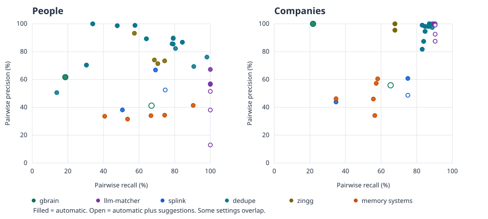

# Finding duplicate people and companies: when a shared ID is wrong

- **We learned that the tested rule kept all 188 different-company pairs apart (0%; 95% interval 0% to 2.00%), but it joined 36 of 488 different-person pairs (7.38%; 5.38% to 10.04%).** You should check a suggested person match before your agent combines the notes, even when the two pages share a profile link.
- **We learned that a review list can catch more real duplicates without changing anyone's notes.** In this test, gbrain's contact-key list held 114 true matches and 79 wrong ones. You should show what differs on the two pages and ask for a decision on each match.
- **We learned that a matcher can find every planted person duplicate and still join many different people.** Even Opus 5.5's direct “yes” answers, after following chains of links, joined 150 of 488 different-person pairs (30.74%; 26.81% to 34.97%). You should measure bad merges as well as the duplicates you find.

These are **stress rates on invented hard cases, not field rates**. The study ran November 18–20, 2026, under the [frozen plan and five amendments](2026-11-18-entity-dedupe-h2h-preregistration.md). It measured gbrain v0.60.738.0 (`0a008fe5`), arm 7 of the [earlier rule study](2026-11-17-person-dedupe.md). The [repository's pin](../gbrain-under-test.md#the-pin) has since moved; it isn't the build measured here.

| Language-model matcher | Correct direct decisions | Cost per correct decision | Different people joined with “yes” alone (Wilson 95%) | Different companies joined with “yes” alone (Wilson 95%) |
|---|---:|---:|---|---|
| [`claude-opus-5-5`](2026-11-18-entity-dedupe-h2h/counted/claude/matcher-summary.json) | 834 of 1,059 | $0.09229 | 150/488 (30.74%; 26.81% to 34.97%) | 0/188 (0%; 0% to 2.00%) |
| [`particle-1`](2026-11-18-entity-dedupe-h2h/counted/particle/matcher-summary.json) | 684 of 1,059 | $0.00685 | 232/488 (47.54%; 43.15% to 51.97%) | 0/188 (0%; 0% to 2.00%) |
| [`gpt-6.2-sol`](2026-11-18-entity-dedupe-h2h/counted/gpt/matcher-summary.json) | 656 of 1,059 | $0.02249 | 238/488 (48.77%; 44.36% to 53.20%) | 0/188 (0%; 0% to 2.00%) |

A **correct direct decision** is a “yes” on a planted same-entity pair or a “no” on a planted different-entity pair, before following any chains. “Unsure” isn't correct, and we don't grade pairs without a planted label for this measure. The numerator of the price ratio covers **all** matcher calls with provider-reported usage, including calls on pairs without a planted label. We priced the normalized input, cache read, cache write and output token counts from those calls at the [bench's list rates](../../eval/runner/budget-ledger.ts), using peak list rates for particle-1. Requests that failed with a server error or timed out returned no usage and were asked again (71 for `gpt-6.2-sol`, 1 for particle-1, none for Opus); they aren't in the numerator, so if the provider billed any of them the true cost is a little higher. That lower price came with **16.80 percentage points more** automatic people false merges than Opus (paired 95% interval 13.68 to 20.42 points; family-instance interval 14.11 to 19.51). This score uses the fixed answer key, not a model judge.

## The concrete case

Imagine two people named Sam Lee. One used a GitHub login years ago; the other uses it now. Two notes from different sources can carry the same name and the same login and still describe different people. A copied LinkedIn link or a mistyped record ID has the same problem. When software joins those pages, an agent can put one person's job, contact details or history on the other person's record.

[gbrain](https://github.com/garrytan/gbrain) keeps notes as Markdown and indexes them for agents. Its duplicate finder in the measured build can report likely matches without applying them. The automatic rule tested here required the same strict name, one page per source, and a shared profile or declared ID that no outside page carries; it also checks for conflicting IDs and checks the group before joining it. A shared email, phone number, X handle or company domain alone doesn't qualify. The rule checks what's *written* on the pages. It can't tell who really owns a copied ID.

## gbrain: what it joined and what it proposed

The automatic tier is what the measured rule would link. The proposed tier adds every non-conflict suggestion to it for scoring. It measures what would happen if every suggestion were accepted; it isn't a set of merges applied for users.

| gbrain v0.60.738.0, arm 7 | People false merges (Wilson 95%) | People recall | Companies false merges (Wilson 95%) | Companies recall |
|---|---|---|---|---|
| Automatic | 36/488 (7.38%; 5.38% to 10.04%) | 58/312 (18.59%) | 0/188 (0%; 0% to 2.00%) | 27/124 (21.77%) |
| Proposed, including automatic | 296/488 (60.66%; 56.25% to 64.89%) | 209/312 (66.99%) | 64/188 (34.04%; 27.65% to 41.08%) | 81/124 (65.32%) |

**After this run the gbrain team decided not to auto-link people. In the shipping design the automatic tier for people is empty, and the proposed (confirm) tier is what users see.** The measured rows above stay v0.60.738.0 (`0a008fe5`), arm 7; they are not a rerun of the shipping design.

The 36 automatic people false merges came in three families: recycled GitHub login, LinkedIn pasted onto the wrong person's page, and a declared-ID typo. Each was 12 of 16 designed different-person pairs (75.00%; Wilson 95% interval 50.50% to 89.82%). The family-instance interval on the full people rate was 5.93% to 8.85%. The company arm also kept all 16 founder-versus-company pairs apart even when they shared a LinkedIn path. The company zero is an observation on these cases, not a guarantee on other company pages.

The confirm list for contact keys is narrower than the proposed tier above. The measured list contained **193 entries: 114 real, 79 wrong (40.93%), and zero with a conflicting-ID veto**. Another 42 contact-key entries carried a veto and were already outside the list; all 42 described different entities. The [finder output](2026-11-18-entity-dedupe-h2h/counted/gbrain/finder.json) records these as conflicts.

## Classic matchers: tune for suggestions, not unattended links

The classics read records parsed from the same rendered pages. [Splink 5.0.0](../../eval/adapters/er-h2h/README.md) (MIT) fits match weights without labels on the data it scores. Its default here adapts the Getting Started people example; the company mapping and tuned review threshold are ours. [dedupe 3.0.3](https://github.com/dedupeio/dedupe) (MIT) learns from labelled examples and uses five labeller seeds per setting. [Zingg Community 0.7.0](https://github.com/zinggAI/zingg) (AGPL-3.0, Spark 3.5.5) learns from labels and runs as a separate process, once per setting because it exposes no seed setting. Neither dedupe nor Zingg exposes a review tier here. The [adapter settings](../../eval/adapters/er-h2h/configs/) record which parts come from the tools' documentation and what we adapted to these pages.

Tuned Splink's **review point** found 326/436 true pairs (74.77%) and joined 309/676 different pairs (45.71%), against 290/436 (66.51%) and 360/676 (53.25%) for gbrain's proposed tier. It cleared both margins across the two types combined and for people alone, **not for companies alone**. On companies, its review point found more duplicates, but it raised false merges from 64/188 to 98/188. Don't treat the combined result as a reason to use the lower threshold on company records.

Every row below is the spread across **all five** dedupe seeds, not a seed we picked after scoring. Counts are shown over the same denominators as gbrain. The [full table](2026-11-18-entity-dedupe-h2h/analysis/operating-points.md) gives every seed's Wilson intervals and all Zingg and Splink settings.

| dedupe setting | People false merges / recall | Company false merges / recall | Combined false merges / recall |
|---|---|---|---|
| Default, 100 labels | 0–40/488; 95–200/312 | 0–23/188; 103–105/124 | 0–63/676; 198–305/436 |
| Default, full labels | 0–40/488; 95–200/312 | 0–23/188; 103–105/124 | 0–63/676; 198–305/436 |
| Tuned, 100 labels | 26–52/488; 43–263/312 | 0/188; 107–108/124 | 26–52/676; 150–371/436 |
| Tuned, full labels | 27–123/488; 247–306/312 | 0–1/188; 108–110/124 | 27–124/676; 355–414/436 |

The default dedupe setting keeps the library's own labelling rule, which stops after 10 matching and 10 non-matching answers. Here that took 20 to 31 labels per record type, so the 100-label limit never came into play: the 100-label and full-label default runs asked the same questions and scored the same, seed for seed. The tuned setting keeps asking until it reaches its limit (100 labels, or 200 for the full-label runs), so its two rows differ.

## Memory systems

The [comparison bundles](../comparison-systems.md#systems-in-the-head-to-head-scoreboard) name the projects and lock their dependencies. Each memory system read the same pages in the same order, used `gpt-6.2-sol` and kept its own default embedder. Each distinct configuration ran once. These are automatic merges; there was no review tier, so each proposed score is the same as its automatic score. **Unresolved** means the readout could not map a page's subject to an entity. An unresolved page cannot make a merge but remains in the original pair denominators.

| System and setting | People false merges (Wilson 95%) | People recall | Companies false merges (Wilson 95%) | Companies recall | Unresolved |
|---|---|---|---|---|---:|
| [`ext-memory-bank` 1.2.1](../comparison-systems/ext-memory-bank/entity-h2h/capability.json), default and tuned | 355/488 (72.75%; 68.63% to 76.51%) | 232/312 | 68/188 (36.17%; 29.64% to 43.25%) | 69/124 | 191 |
| [`ext-graph-pipeline` 1.6.8](../comparison-systems/ext-graph-pipeline/entity-h2h/capability.json), default **patched** | 385/488 (78.89%; 75.05% to 82.28%) | 208/312 | 53/188 (28.19%; 22.25% to 35.01%) | 71/124 | 41 |
| `ext-graph-pipeline` 1.6.8, tuned, patched (`similarity-0.70`) | 215/488 (44.06%; 39.72% to 48.49%); most people subjects were unresolved | 127/312 | 54/188 (28.72%; 22.73% to 35.57%) | 70/124 | 897 (804/1,576 people; default 41 overall) |
| [`ext-graph-pipeline` 1.6.8, out of the box](2026-11-18-entity-dedupe-h2h/counted/ext-graph-pipeline-out-of-the-box/cell.json) | Failed (infrastructure) | — | Not scored | — | — |
| [`ext-temporal-graph` 0.31.2](../comparison-systems/ext-temporal-graph/entity-h2h/capability.json), default and tuned | 391/488 (80.12%; 76.35% to 83.42%) | 282/312 | 59/188 (31.38%; 25.18% to 38.33%) | 72/124 | 48 |
| [`ext-extract-first` 2.2.1](../comparison-systems/ext-extract-first/entity-h2h/capability.json), default and tuned | 360/488 (73.77%; 69.69% to 77.48%) | 167/312 | 62/188 (32.98%; 26.66% to 39.98%) | 43/124 | 55 |

- **`ext-memory-bank` (MIT)** documents a minimum name similarity of 0.3 for reusing an entity. The [held-out comparison](2026-11-18-entity-dedupe-h2h/counted/choice-ext-memory-bank.json) kept the default, so the tuned cell is the default cell.
- **`ext-graph-pipeline` (Apache-2.0)** documents a default of 0.85 for similarity between name embeddings, with name matching enabled. Its first attempt crashed on a connection reset at page 1,626 of 2,106. The logs don't show what caused that reset. The restart on a bigger VM ingested all 2,106 pages and failed in the system's own entity consolidation. The step embeds every candidate name in one request (`consolidate_entities.py`, line 266 at 1.6.8, unchanged in 1.6.9 and 1.6.10). The counted world yields more than 2,048 names, and OpenAI rejects the request with a 400. The embedder already splits and retries on Vertex's wording of this error, but not on OpenAI's. As of November 19, 2026 there was no upstream fix or issue. The counted default is the **patched** run with OpenAI's wording added to that same retry check (Amendment 5). The [held-out comparison](2026-11-18-entity-dedupe-h2h/counted/choice-ext-graph-pipeline.json) chose 0.70: 104/170 false merges with 72/109 recall, against 107/170 and 74/109 at default. The slice ran on 527 pages; its receipts did not record the pre-consolidation candidate-name count. The count of output entity nodes is a different measure.
- **`ext-temporal-graph` (Apache-2.0)** uses exact names, a fuzzy comparison and a model decision. Out of the box, it sends reasoning effort `'none'` to GPT-6 models and `gpt-6.2-sol` rejects it with a 400. There was no upstream fix in 0.31.2 or on its main branch as of November 18, 2026. The counted run used the client's documented `reasoning=None`, so it sends no effort setting ([client source in the comparison bundle](../comparison-systems/ext-temporal-graph/entity-h2h/capability.json), Amendment 3). There is no documented dedupe setting, so the tuned cell is the default cell.
- **`ext-extract-first` (Apache-2.0)** extracts entity names and uses a fixed similarity threshold of 0.95. Its first counted attempt queued all 2,106 pages and then waited on a single finish step with a one-hour limit, which couldn't cover the roughly 100 minutes extraction needs. The operator stopped that attempt during the wait, about four and a half minutes after it started; the run recorded a crash and scored nothing. Its 282 provider requests before the stop came to $0.35, as Amendment 4 asks the results to report. The counted row is the restart with `drain-each`, which waits for each page before sending the next (Amendment 4). There is no documented dedupe setting, so the tuned cell is the default cell.

We checked the same 50 seeded page-to-entity assignments per scored memory configuration against the input titles and returned source references. The samples had 5 unresolved pages for [`ext-memory-bank`](2026-11-18-entity-dedupe-h2h/counted/ext-memory-bank/hand-check-sample.json), 0 for [`ext-temporal-graph`](2026-11-18-entity-dedupe-h2h/counted/ext-temporal-graph/hand-check-sample.json), 1 for [`ext-extract-first`](2026-11-18-entity-dedupe-h2h/counted/ext-extract-first/hand-check-sample.json), and 1 for [patched default](2026-11-18-entity-dedupe-h2h/counted/ext-graph-pipeline-patched/hand-check-sample.json) versus 24 for [tuned](2026-11-18-entity-dedupe-h2h/counted/ext-graph-pipeline-tuned/hand-check-sample.json). Two tuned assignments used a different first name unsupported by the corresponding page. One memory-bank email node wasn't in its input page. Exact names and valid source references don't prove that a node kept two same-named people apart. We didn't rewrite any scores based on these checks.

## What each result changes

The differences below are in percentage points. We use exact McNemar tests on the paired binary outcomes (which planted pairs one arm joined and the other did not), plus a two-sided 95% paired score interval and a one-sided upper bound. The one-sided limits are 1 point for excess false merges and 10 points for recall shortfall. The [paired data](2026-11-18-entity-dedupe-h2h/analysis/paired.json) also report family-instance intervals, and separate people, company and combined comparisons for each configuration and tier.

| Preregistered row | Did it fire? |
|---|---|
| Zero automatic errors, with upper bounds at most 1% for people and 3% for companies | **No.** Companies cleared their part (0/188; upper end 2.00%), but people did not (36/488; upper end 10.04%). The joint rule does not pass. |
| Any automatic error | **Yes.** Recycled GitHub logins, wrongly copied LinkedIn links and colliding declared IDs each account for 12 errors. The plan calls for report-only on the affected key classes; the team decided to leave the people automatic tier empty. |
| Every contact-key entry with a conflicting ID is a wrong match | **Already filtered.** This build leaves 0 vetoed entries on the list. All 42 vetoed contact-key entries outside the list are wrong matches. This supports keeping them out; it isn't a new comparison of ways to show a veto. |
| More than one quarter of the remaining confirm list is wrong | **Yes.** 79/193 (40.93%) are wrong. Show differences such as employer, city or dates, put riskier entries last and keep confirmation one entry at a time. |
| Zingg or dedupe with 100 labels keeps within 1 point of automatic false merges and at least doubles recall | **Some dedupe seeds pass; no configuration passes across its scored seeds.** Zingg's best combined upper bound was +7.29 points. Default dedupe clears both combined bars on four of five seeds, but goes to +6.45 at the fifth; tuned dedupe clears both on one of five (combined upper bound +0.45, recall 355/436 vs 85/436). On companies alone, zero versus zero is not enough to meet the 1-point bound (upper bound +1.42). Don't pick a seed to claim a winner. |
| A classic matcher improves on the proposed tier's recall at equal or lower false merges | **Yes.** Tuned Splink's review point adds 8.26 recall points combined (paired 95% interval +4.52 to +12.20; family-instance +5.64 to +10.88); its false-merge difference is −7.54 points (one-sided upper bound −3.82). It also passes on people alone. Its automatic point passes on the combined measure as well (+4.36 recall points; +0.07 to +8.71, false-merge upper bound −24.74). For dedupe, four of five tuned runs with 100 labels and all five tuned runs with full labels pass on the combined measure; the full-label result is the ceiling, not the 100-label test. The decision is to plan a native version of the method, not add a dependency or approve automatic people links. |
| The best language-model matcher improves review-queue precision by at least 5 points | **No.** Opus has the best combined result on review-only pairs: 1/117 real, vs gbrain's 205/531, a gap of −37.75 points (paired family-instance 95% interval −40.26 to −35.15). Using all links at the proposed point instead gives Opus 424/719 and gbrain 290/652, but those include automatic “yes” links and aren't the review list. No opt-in adjudicator is planned on this evidence. |
| gbrain's proposed tier has fewer false merges than a memory system and recall within 10 points | **Yes, against three default settings across people and companies combined.** gbrain joins 360/676 different pairs (53.25%) and finds 290/436 real pairs. The paired comparisons are below. |
| A memory system merges different entities | **Yes, every scored setting.** The versioned rates are in the memory-system table. The original out-of-the-box pipeline run was never scored. |

| Memory comparison, people and companies combined | Memory false merges | gbrain minus memory, false merges (paired 95%; family-instance 95%) | Memory recall | Upper 95% bound on gbrain's recall shortfall |
|---|---|---|---|---|
| `ext-extract-first`, default | 422/676 (62.43%) | −9.17 points (−12.60 to −5.84; −11.83 to −6.46) | 210/436 | −15.32 points |
| `ext-memory-bank`, default | 423/676 (62.57%) | −9.32 points (−13.38 to −5.29; −12.91 to −5.78) | 301/436 | +6.31 points |
| `ext-graph-pipeline`, patched default | 438/676 (64.79%) | −11.54 points (−14.92 to −8.29; −14.18 to −8.85) | 279/436 | −0.24 points |

For people alone, gbrain's proposed tier clears both tests against `ext-extract-first` and patched default `ext-graph-pipeline`. Against `ext-memory-bank` the people recall shortfall bound reaches 12.29 points, above 10. Against `ext-temporal-graph` gbrain has fewer false merges but gives up 23.40 recall points on people and 14.68 points combined. No company-only comparison clears both tests. The 1.06-point company gap against `ext-extract-first` and 2.13-point gap against `ext-memory-bank` were not detected at this sample size. The tuned pipeline trades a lower combined false-merge rate for much lower recall (197/436 vs gbrain's 290/436), so it doesn't match on both.

Settled call: Leave automatic people linking off, require review one entry at a time, and plan a native way to use the stronger classic matching method for suggestions.

## How we counted

The synthetic world has 2,106 pages: 1,576 person pages and 530 company pages, with 20 instances of each case family. The generator and an independent check on the written pages agree on the answer key. There are 488 must-not-link and 312 must-link pairs for people, and 188 must-not-link and 124 must-link pairs for companies. The 16 founder-versus-company pairs count once, under companies. The held-out world for choosing settings uses seed 20261118 and contributes no counted examples.

We score the **final groups**, including links through another page: if A joins B and B joins C, A joins C even if nobody compared A and C. False-merge rate is the share of planted different-entity pairs that end up together. Designed recall is the share of planted true pairs that end up together. Pairwise precision and recall use all page pairs, not just the planted ones; B-cubed averages precision and recall per page before computing their harmonic mean. [Every operating point](2026-11-18-entity-dedupe-h2h/analysis/operating-points.md) links to exact per-family counts, intervals, group causes and errors beyond the planted pairs.



The [analysis script](2026-11-18-entity-dedupe-h2h/analysis/analyze.ts) takes the pair outcomes from the same scorer that closes the groups. It resamples family instances within each family 4,000 times for another 95% interval. It uses the same draws for both arms; for all-page precision and recall it splits a pair's weight evenly between its two source instances. The bootstrap can give a zero-width interval where nothing changed in the observed instances; that isn't a zero-risk guarantee. The stated minimum detectable false-merge differences were about **2 points for people** (81% power) and **5 for companies** (86%; a 4-point gap had 69%), conservative on the larger counted world. If a smaller difference isn't detected at this sample size, that does not make the systems equal.

### Candidates and review work

The matcher compared 25,273 candidate pairs; two surname keys (Marsh and Ulloa) were dropped because each appeared on 52 pages. It reached **312/312** must-link and **483/488** must-not-link people pairs, and **112/124** must-link and **152/188** must-not-link company pairs. The 53 unreached pairs stayed in the denominators. The finder exposed **312/312 and 448/488** respectively for people and **112/124 and 152/188** for companies in its returned groups, including conflicts; this is what the finder surfaced, not a count of its internal comparisons.

The keyless Splink replay matched the recorded group memberships and output sizes. At its prediction cutoff, default Splink retained 242 of the 312 must-link and 419 of the 488 must-not-link people pairs; tuned Splink retained 300 and 374. For companies, default retained 76 of 124 must-link and 109 of 188 must-not-link pairs; tuned retained 93 and 129. These are pairs that survived the prediction cutoff, not necessarily every pair it considered. [Direct predictions](2026-11-18-entity-dedupe-h2h/counted/splink-tuned/direct-edges.json) show, for example, how the tuned review point joined 191 different-person pairs before closure and 211 after, and 96 different-company pairs before closure and 98 after. The other classic adapters and the memory-system readouts did not record a common pre-merge candidate list, so those reach counts are unavailable.

Before closure, “yes” on a different-entity pair occurred 130 times for Opus, 197 for particle-1 and 198 for Sol; there were no “no” answers on a must-link pair. Including “unsure” adds 94, 177 and 205 direct false links, respectively. No matcher had a safety-filter refusal, unparsed answer or missing final verdict. The logs record 0, 1 and 71 requests made again, respectively. Each matcher used the frozen yes/no/unsure prompt and its default reasoning (high sent explicitly for particle-1); none ran in a coding-agent harness.

Review work counts suggestions that add at least one pair not already joined automatically. A group is real only if every page describes the same entity. The comparison of review precision uses the unique pairs shown by those suggestions, excluding pairs already joined automatically.

| System and review tier | Suggested groups per 1,000 pages | Groups entirely real |
|---|---:|---:|
| gbrain, proposed beyond automatic | 217.95 | 170/459 (37.04%) |
| gbrain, contact-key confirm list only | 91.64 | 114/193 (59.07%) |
| Tuned Splink, bench review band | 65.53 | 16/138 (11.59%) |
| `claude-opus-5-5`, “unsure” beyond “yes” | 55.56 | 1/117 (0.85%) |
| `particle-1`, “unsure” beyond “yes” | 87.84 | 1/185 (0.54%) |
| `gpt-6.2-sol`, “unsure” beyond “yes” | 157.17 | 0/331 (0%) |

The other settings propose no separate groups. The classic tools process people and companies separately. The readout for a memory system depends on what it extracts and on whether we can map every page back to its subject. Neither this test nor the proposed-tier comparisons tell you how often teams will see these cases in production or how many suggestions they'll accept.

## Reproduce and inspect

The [public counted data](2026-11-18-entity-dedupe-h2h/counted/README.md) covers 35 completed configurations and one failed configuration. [The seed reveal](2026-11-18-entity-dedupe-h2h/counted/seed-reveal.json) records seed 1975418963, its nonce and the checked SHA-256 commitment. The first counted world was built at [`b85a4eb`](https://github.com/garrytan/gbrain-evals/commit/b85a4eb57358913ff1edb09bc6aa672cc14e893d), after the harness baseline named in Amendment 1 ([`efa7719`](https://github.com/garrytan/gbrain-evals/commit/efa77190d01f154c8207a7692a9904e83c63c529)); the later runs used the changes in the dated amendments. The gbrain import receipt records 53.2 seconds across both sources. The successful memory attempts took about 1 hour 51 minutes to 8 hours 26 minutes; each cell records its own times.

From the repository root, the following rebuilds the world, rescores the saved keyless gbrain run and regenerates the paired analysis without calling any provider. Pick a fresh output directory. To rescore another completed run, point `score` at its counted folder.

```sh
report=docs/benchmarks/2026-11-18-entity-dedupe-h2h
world=$(mktemp -d)
bun --no-env-file eval/runner/entity-h2h/run.ts world --seed 1975418963 --per-family 20 --output "$world"
bun --no-env-file eval/runner/entity-h2h/run.ts score --world "$world" "$report/counted/gbrain"
bun --no-env-file "$report/analysis/analyze.ts" "$world" > paired.json
```

## Disclosures

gbrain is Garry Tan's own project.

Disclosure: OpenAI began through YC Research, which was started by Sam Altman, a former president of Y Combinator. Garry Tan runs Y Combinator.

Disclosure: Y Combinator, which Garry Tan runs, is an investor in Particle, which makes particle-1.
