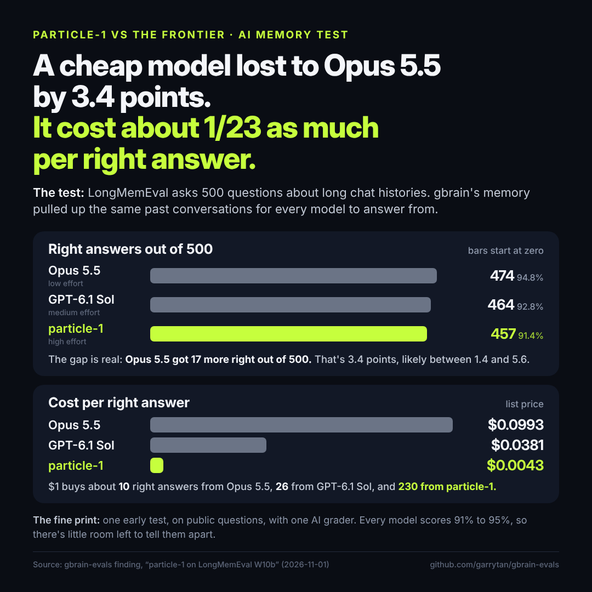

# particle-1 answers 91.4% of 500 LongMemEval questions on gbrain's retrieval, 3.4 points behind Opus 5.5 (95% interval 1.4 to 5.6), at about a twenty-third of its list cost per correct answer (exploratory, public dev set, near ceiling, one protocol judge)

**Publication status:** unpublished. Done: a keyless recount of every number from the committed rows, a clean-machine
rerun and claim check with a cross-family review, which passed the file with edits that this version applies (see
[the claim check](#the-claim-check)), and dated notes beside the corrected cost figures in the reports this file cites.
Garry Tan answered the disclosure questions on 2026-11-02, so the gbrain and OpenAI lines join the Particle line in
[Disclosures](#disclosures), and Anthropic, DeepSeek and Google get none. At his request the lines close this file, and
the X post carries none. A recheck of the edited and added lines passed on 2026-11-02. Still blocking a post: Garry Tan's
approval of the post text.

## What we found

We gave particle-1 the exact prompts that three frontier readers, Opus 5.5, Sonnet 5.5 and GPT-6.1 Sol, answered in
October: 500 LongMemEval-S questions, each
with the conversations gbrain retrieved for it. Under LongMemEval's own judge (`gpt-4o-2024-08-06`), particle-1
answered 457 correctly (91.4%) against Opus 5.5's 474 (94.8%), a paired difference of -3.4 points (95% interval -5.6
to -1.4). It cost $0.0043 per correct answer at list price against Opus 5.5's $0.0993.

Every reader scores 91% to 95% here, so the comparison is near the ceiling. Against Sonnet 5.5 (462, 92.4%) and
GPT-6.1 Sol (464, 92.8%), the protocol judge cannot tell particle-1 apart: the differences are -1.0 points (-3.2
to +1.0) and -1.4 points (-3.6 to +0.6), and the test could only have detected gaps of 3.1 and 3.0 points. This is
not evidence of parity. In a sensitivity check added after the run and not counted, where each pair is judged by a
model from a lab with no arm in that pair, particle-1 trails Sonnet 5.5 by 2.4 points (-4.6 to -0.4) and GPT-6.1
Sol by 3.4 points (-5.6 to -1.2).

## How it works

*An explanation, not a result.* Every reader here is near the ceiling, so the comparison turns on 29 to 31 questions
where two readers disagree. Most of particle-1's 17-question gap to Opus 5.5 is in two types: single-session-preference
(23 of 30 against 30) and multi-session (105 of 121 against 109). gbrain's notes prompt tells the reader to say "The
information is not available in the retrieved sessions; I don't know." when the sessions lack what it needs. particle-1
applies that rule, nearly word for word, to requests for advice, where LongMemEval's rubric expects the reader to use
preferences the user stated earlier ([replay report, the concrete case](../benchmarks/2026-11-01-longmemeval-particle-replay/REPORT.md#the-concrete-case)).
Its answers are also short: a median of 192 characters against 518.5 for Opus 5.5, 468.5 for Sonnet 5.5 and 166.5 for
GPT-6.1 Sol. Open-ended rubric questions are where judges disagree most. Five of the 15 particle-1 answers that the
`claude-sonnet-5-5` judge marks wrong, against gpt-4o's right, are single-session-preference answers.

## Setup

- **Question.** Accuracy of particle-1 minus each frontier reader, paired by question, reading the same retrieved
  context.
- **Tasks.** The 500 questions of LongMemEval's cleaned `_s` split (`longmemeval_s_cleaned.json`, SHA-256
  `d6f21ea9d60a0d56f34a05b609c79c88a451d2ae03597821ea3d5a9678c3a442`, not committed). Each prompt holds the
  conversations behind gbrain `a7cb37b`'s top five retrieved passages, frozen on 2026-09-29 for W10 and rendered
  with gbrain's notes prompt. The dataset's licence is MIT (its Hugging Face card, `xiaowu0162/longmemeval-cleaned`,
  checked 2026-11-01).
- **Arms.** This is a reader comparison on fixed retrieval, so it has no skill or placebo arm. W10c's whole-history
  arms, where the reader gets the entire history and no retrieval, are summarised in the replay report.
  - `particle:particle-1`, effort `high`, `max_completion_tokens` 16,000, no temperature or seed, through
    Particle's API on 2026-11-01 (every response reported `particle-ai/particle-1` at the `default` tier, and
    `weight_version` was null in all 500). The replay runner is `eval/runner/batch/w10-particle.ts` at `e29ad9c1`.
  - `claude-opus-5-5` and `claude-sonnet-5-5` at `output_config.effort: "low"` with 4,096 output tokens, and
    `gpt-6.1-sol` at `reasoning_effort: "medium"` with 12,000 completion tokens. These are W10's settings, run
    through the providers' batch APIs on 2026-10-06
    ([W10b](../benchmarks/2026-10-07-longmemeval-w10b-reader-replay.md)).
  - W10b's fourth notes-prompt reader, Fable 5.1, is left out: it answered a seeded 200-question subset, not the 500,
    and this repository runs Fable only in smoke tests, never in counted cells.
  - particle-1's prompts are the comparators' committed request bodies, rebuilt and checked against W10's manifests
    (`body_sha256`), so every reader saw the same system and user text.
- **Protocol judge.** LongMemEval's official prompt (`evaluate_qa` answer check, protocol digest
  `efcf3d0d581bcd5e4b278c3a77378a0c97b15941c58e77ba93f2b5f216414753`) on `gpt-4o-2024-08-06`, temperature 0,
  10 output tokens. An answer is correct when the reply contains "yes". gpt-4o is an OpenAI model, so by protocol it
  judges the GPT-6.1 Sol arm from Sol's own lab. Judge calibration against human labels: not recorded.
- **Second judges (sensitivity added after the run, not preregistered, not counted).** The same prompt, run on
  2026-11-01. Each pair is judged by a model from a
  lab with no arm in it: `gpt-6.1-sol` judges particle-1, Opus 5.5 and Sonnet 5.5, and `claude-sonnet-5-5` judges
  particle-1 and GPT-6.1 Sol. Both run at effort `low` with 2,000 output tokens, because a reasoning model cannot
  answer in 10. Neither provider offers a dated snapshot of these models. The receipt records each listing's date
  (gpt-6.1-sol created 2026-09-27, claude-sonnet-5-5 2026-09-28) and every response's model, which was the requested
  id in all 2,500.
- **Statistics.** Paired differences with 95% cluster-bootstrap intervals (10,000 draws, seed 20261101, the method of
  `eval/runner/compare.ts`) and exact two-sided McNemar tests. One answer per question per reader.

## Result

The preregistered rule for this comparison is decision B's stop rule. If the upper bound of particle-1 minus Opus 5.5
were below -10 points, the report would have to say so first. The upper bound is -1.4, so the rule does not fire. The
paired differences are preregistered as descriptive.

```text
                               particle-1 minus this reader, points     $ per correct answer
                               (95% interval, protocol judge)           list     billed
                               -6   -5   -4   -3   -2   -1    0    +1
                               -+----+----+----+----+----+----+----+-
claude-opus-5-5    474 (94.8%)    [==========*=========]      :         $0.0993  $0.0497 (batch)
claude-sonnet-5-5  462 (92.4%)                [==========*=========]    $0.0500  $0.0250 (batch)
gpt-6.1-sol        464 (92.8%)              [==========*=========]      $0.0381  $0.0190 (batch)
particle-1         457 (91.4%)                                |         $0.0043  $0.0021 (off-peak)
```

In the chart, * is the paired difference, the brackets its 95% interval and the colon zero. Billed is what was paid:
the comparators at batch price, and particle-1 in Particle's off-peak window (see [Cost](#cost)).

| Reader | Correct, protocol judge | particle-1 minus this reader (95% interval) | particle-1 wins / losses | McNemar p | Smallest gap detectable at 80% power | $ per correct, list |
|---|---|---|---|---|---|---|
| `particle-1` | **457 (91.4%)** | | | | | **$0.0043** |
| `claude-opus-5-5` | 474 (94.8%) | **-3.4 (-5.6 to -1.4)** | 6 / 23 | 0.002 | 3.0 | $0.0993 |
| `claude-sonnet-5-5` | 462 (92.4%) | -1.0 (-3.2 to +1.0) | 13 / 18 | 0.47 | 3.1 | $0.0500 |
| `gpt-6.1-sol` | 464 (92.8%) | -1.4 (-3.6 to +0.6) | 11 / 18 | 0.26 | 3.0 | $0.0381[^sol] |

[^sol]: $0.0307 as committed in the replay report. W10 settled GPT-6.1 Sol's rows before the budget ledger priced
    OpenAI cache writes, and Sol's responses report almost every prompt token as a cache write, which OpenAI prices at
    $2.50 per million rather than $2.00. See [corrections](../corrections.md#longmemeval).

**Sensitivity added after the run: cross-family second judges.** Not preregistered and not counted. Agreement and
Cohen's kappa are measured against the protocol judge's verdicts on the same answers.

| Judge | Arm | Correct, protocol judge | Correct, second judge | Agreement | Kappa | Right to wrong | Wrong to right |
|---|---|---|---|---|---|---|---|
| `gpt-6.1-sol` | particle-1 | 457 | 456 | 97.4% | 0.836 | 7 | 6 |
| `gpt-6.1-sol` | Opus 5.5 | 474 | 480 | 98.4% | 0.818 | 1 | 7 |
| `gpt-6.1-sol` | Sonnet 5.5 | 462 | 468 | 98.0% | 0.846 | 2 | 8 |
| `claude-sonnet-5-5` | particle-1 | 457 | 444 | 96.6% | 0.810 | 15 | 2 |
| `claude-sonnet-5-5` | GPT-6.1 Sol | 464 | 461 | 98.2% | 0.870 | 6 | 3 |

| particle-1 minus | Protocol judge | Cross-family judge | Second judge's difference (95% interval) | Wins / losses | McNemar p | Interval moves? |
|---|---|---|---|---|---|---|
| Opus 5.5 | -3.4 (-5.6 to -1.4) | `gpt-6.1-sol` | -4.8 (-6.8 to -3.0) | 1 / 25 | < 0.001 | no: still excludes zero |
| Sonnet 5.5 | -1.0 (-3.2 to +1.0) | `gpt-6.1-sol` | -2.4 (-4.6 to -0.4) | 9 / 21 | 0.043 | yes: now excludes zero |
| GPT-6.1 Sol | -1.4 (-3.6 to +0.6) | `claude-sonnet-5-5` | -3.4 (-5.6 to -1.2) | 8 / 25 | 0.005 | yes: now excludes zero |

The protocol's rule reads a reply as correct when it contains "yes" anywhere. `gpt-6.1-sol` answered with a bare yes or
no every time, but `claude-sonnet-5-5` reasoned in some replies. On question `7405e8b1`, its replies for both
particle-1's and GPT-6.1 Sol's answers quote "Yes" and end with "No", so the rule counts both correct. Read by their
last yes or no, the Sonnet-judged counts are 443 and 460 (kappa 0.823 and 0.886), and particle-1 minus GPT-6.1 Sol stays
-3.4 (-5.6 to -1.2), because both replies fall on the same question.

The `gpt-6.1-sol` judge is stable. On the Opus 5.5 and Sonnet 5.5 answers, W10 ran the same model as its secondary
judge in October. Those verdicts give the same totals (480 and 468) and agree with this run on 498 of 500 answers for
each arm. Every judgment is in the second-judge rows, and the per-type counts and every figure above are in
[analysis.txt](2026-11-01-particle-1-longmemeval-w10b/analysis.txt).

## Cost

Reader cost on the 500 questions, from each row's token usage at the list prices below. Judging is excluded.

| Reader | Mean input / output tokens per question | List $ per question | List $ per correct | Batch $ per correct | Arm total, list |
|---|---|---|---|---|---|
| `particle-1` | 13,951 / 425 (357 of them reasoning) | $0.0039 | $0.0043 | none (about $0.0021 off-peak) | $1.96 |
| `claude-opus-5-5` | 22,077 / 294 | $0.0942 | $0.0993 | $0.0497 | $47.09 |
| `claude-sonnet-5-5` | 22,077 / 203 | $0.0462 | $0.0500 | $0.0250 | $23.09 |
| `gpt-6.1-sol` | 13,695 / 110 | $0.0353 | $0.0381 | $0.0190 | $17.67 |

At list price, particle-1's cost per correct answer is about a twenty-third of Opus 5.5's, a twelfth of Sonnet 5.5's
and a ninth of GPT-6.1 Sol's. Input tokens are as each provider counts them; particle-1's listing names DeepSeek's
tokenizer, and the Anthropic readers count about 60% more tokens for the same text than the other two. particle-1 has
no batch API. Every particle-1 call in the replay ran in Particle's off-peak window, so Particle's charge was about half
the list figure, about $0.0021 per correct answer. The comparators ran through batch APIs at half the list price.
Both discounts are half, so what was actually billed keeps the same ratios, about 23, 12 and 9 times. A caller paying
particle-1's peak list price against the comparators' batch prices gets half those ratios, about 12, 6 and 4 times.

**Price table**, USD per million tokens, checked on 2026-11-01 against each provider's page:

| Model | Input | Cache write | Output | Discount | Source |
|---|---|---|---|---|---|
| `particle-1` | $0.25 | none reported | $1.00 | 50% off-peak (20:30 to 04:00 New York time) and 50% on the flex tier; neither applied to the list figures | [Particle usage and billing](https://docs.particle.ai/usage-billing) |
| `claude-opus-5-5` | $4.00 | none reported | $20.00 | Batch API 50% | [Anthropic pricing](https://platform.claude.com/docs/en/about-claude/pricing) |
| `claude-sonnet-5-5` | $2.00 | none reported | $10.00 | Batch API 50% | [Anthropic pricing](https://platform.claude.com/docs/en/about-claude/pricing) |
| `gpt-6.1-sol` | $2.00 | $2.50 | $10.00 | Batch API 50% | [OpenAI pricing](https://developers.openai.com/api/docs/pricing) |
| `gpt-4o-2024-08-06` (protocol judge) | $2.50 | none reported | $10.00 | none used | [OpenAI pricing](https://developers.openai.com/api/docs/pricing) (listed as `gpt-4o`) |

**Cache tokens.** No reader's rows report cached reads. GPT-6.1 Sol's rows report 6,845,950 of their 6,847,450 prompt
tokens as cache writes, which are priced at the cache-write rate above. The replay report and W10 priced them at the
input rate, which is where the committed $0.0307 comes from. OpenAI's billing API refused our key, so the invoice could
not be checked; the Sol figures follow OpenAI's published rate and the usage the responses reported.

**Judging and this finding's spend.** The replay's gpt-4o judging cost $0.48 for all four of its arms. The second
judges cost $1.607 for 2,491 paid requests, as the run's receipt records from the budget ledger; a smoke test before
the run added 6 requests and $0.003 that no committed file records. By judge: `gpt-6.1-sol` $0.86 for
1,500 judgments, `claude-sonnet-5-5` $0.75 for 1,000. On nine questions GPT-6.1 Sol's answer is byte-identical to
particle-1's, so the `claude-sonnet-5-5` prompt was identical too. Those nine Sol judgments were replayed from the same
run's response cache, share particle-1's verdict and were not paid again. The run's receipt still prices them ($0.004),
so its per-judge figures add up to $1.611 against the ledger's $1.607 for the full run. The cap was $25, with a stop at $20.

## Why null? (R48)

This section covers the two comparisons the protocol judge cannot separate: particle-1 against Sonnet 5.5 and against
GPT-6.1 Sol.

- **Exposure.** particle-1 read every prompt in full, with the same text the comparators read. It answered all 500,
  with no reader errors and no answer cut off at its output limit, and spent 357 reasoning tokens per answer on average.
- **Task fit.** Answering from retrieved conversations is the whole reader task, and the 500 questions span all seven
  of LongMemEval's question types. particle-1's weak spot is single-session-preference (23 of 30, against 29 for both
  Sonnet 5.5 and GPT-6.1 Sol), where the rubric rewards using remembered preferences over saying the fact is missing.
- **Power and saturation.** Sonnet 5.5 and GPT-6.1 Sol answer 92.4% and 92.8%, so 36 to 38 questions are left to
  separate the readers, and 31 and 29 questions are discordant. With 500 pairs the test has 80% power for about 3.1
  and 3.0 points. The observed gaps of 1.0 and 1.4 points are below that, so the null is not evidence of no effect.
- **Frontier competence.** Today's frontier readers already score 92% to 95% on this retrieval, so particle-1 offers
  lower cost here, not higher accuracy.
- **Judge.** In the sensitivity check added after the run (not counted), both cross-family judges put particle-1
  behind, by 2.4 and 3.4 points, with intervals that exclude zero. So the null depends on the judge as well as on power.
- **Verdict: FIX-METHOD.** This benchmark, at this ceiling and with one judge, cannot settle whether particle-1 matches
  Sonnet 5.5 or GPT-6.1 Sol as a reader. A useful next test is a harder memory set where readers score well below 90%,
  with a preregistered non-inferiority margin and a second judge counted beside the protocol judge. Kill rule: if no
  memory set can be admitted with the comparators below 90% and an MDD inside a preregistered non-inferiority margin,
  or the test runs and particle-1 fails that margin against Sonnet 5.5 or GPT-6.1 Sol, stop testing particle-1 for
  reader parity and report it as a cheaper reader that trails the frontier.

## Limits and threats

- **Ceiling and power.** Every reader scores 91% to 95%. The gap to Opus 5.5 rests on 29 discordant questions, and the
  gaps to Sonnet 5.5 and GPT-6.1 Sol are below what the test can detect.
- **One protocol judge.** The counted verdicts come from one OpenAI model, which also judges the GPT-6.1 Sol arm. The
  [W8 control](../benchmarks/2026-10-06-w8-longmemeval-control.md) shows that the official judge accepts some "the
  information is not available" answers to answerable questions. The second judges are not counted, differ from the
  protocol in output room and reasoning, and have no dated snapshot. A rerun of all four arms judged by Gemini, a lab
  with no arm in this comparison, is future work.
- **No human grading.** No person graded the verdicts, and no judge was calibrated against human labels. Inspection
  was limited to the W8 control, the replay report's two preference questions (`09d032c9`, `0edc2aef`) and question
  `7405e8b1`.
- **One sample per question.** Each reader answered once at the provider's default sampling.
  [W10a](../benchmarks/2026-10-07-longmemeval-w10a-current-pin.md) found two identical runs of one reader differing on
  13 of 500 answers. particle-1 is not deterministic even at temperature 0 with a seed: in the replay's weight canary,
  1 to 3 of 12 answers changed between back-to-back runs.
- **Exclusions and retries.** No question was excluded: all 500 are scored in every arm, with no reader errors and no
  truncated answers. Nine `claude-sonnet-5-5` verdicts on GPT-6.1 Sol came from the same run's cache, because Sol's
  answer was byte-identical to particle-1's.
- **Settings are W10's, not matched.** particle-1 ran at effort `high`, Opus 5.5 and Sonnet 5.5 at `low`, and GPT-6.1
  Sol at `medium`. Other settings would change both accuracy and cost. At effort `none`, particle-1 lost 11.3
  points on W10c's 150 questions (118 against 135).
- **Retrieval and time.** The retrieval is gbrain `a7cb37b` from 2026-09-29, not today's pin. The comparators
  answered through batch APIs on 2026-10-06, and particle-1 answered through Particle's real-time API on 2026-11-01.
- **Public, development data.** LongMemEval-S is public and has been used throughout gbrain's development, so the
  questions are not held out, and models may have seen them in training.
- **Cost.** List prices come from the providers' pages on 2026-11-01. The GPT-6.1 Sol invoice is unconfirmed, and
  Particle's charge is estimated from usage fields, because Particle has no API that reads the credit balance.
- **What this does not show.** Anything about gbrain's retrieval, other memory tasks, or particle-1 as an agent or as a
  memory writer.

## Replicate it

1. **Reanalysis, keyless.** Python 3's standard library is the only requirement.

   ```bash
   git clone https://github.com/garrytan/gbrain-evals && cd gbrain-evals
   git checkout 23eb96e3c87fc53cab1819e32759728915fabf9f
   sha256sum -c docs/findings/2026-11-01-particle-1-longmemeval-w10b/SHA256SUMS
   python3 scripts/finding-particle-w10b.py --check
   ```

   The script recounts this file's counts, intervals, costs, answer lengths, reasoning tokens and second-judge figures
   from the per-question rows: verdicts from the stored judge replies, the paired intervals with `compare.ts`'s
   bootstrap, cost from each row's token usage and the price table, and agreement, flips by type and the last-word
   reading for the second judges. It checks the digests and the replay's `summary.json` first, and copies the
   detectable gaps from `summary.json`'s power notes. The judging costs come from the replay report and the
   second-judge receipt, and the canary figures from the replay report. `--check` exits 1
   unless its output equals the committed [analysis.txt](2026-11-01-particle-1-longmemeval-w10b/analysis.txt) and
   [analysis.json](2026-11-01-particle-1-longmemeval-w10b/analysis.json) byte for byte.

2. **Rerun the second judges, paid, about $1.61.** This needs `OPENAI_API_KEY`, `ANTHROPIC_API_KEY`, Bun and
   `jq`. The budget ledger is a local SQLite file.

   ```bash
   bun install --frozen-lockfile
   bun eval/runner/budget-ledger.ts init --budget-ledger <ledger> --program-cap-usd 25
   RUN=$(bun eval/runner/budget-ledger.ts open --budget-ledger <ledger> --runner w10-particle-second-judge --budget-usd 20 --estimate-usd 10 | jq -r .run_id)
   bun eval/runner/batch/w10-particle-second-judge.ts run --out <fresh dir> --budget-ledger <ledger> --paid --budget-run-id $RUN
   ```

   Each run judges through a fresh temporary response cache unless `--cache` names one, so a rerun pays for every
   judgment instead of replaying an earlier run's.

   The fresh run's `rows.ndjson` files can replace the committed ones under
   `docs/findings/2026-11-01-particle-1-longmemeval-w10b/second-judge/` for the script to read. Expect a few verdicts
   per arm to differ: the same judge agreed with itself on 498 of 500 answers a month apart.

3. **Rerun particle-1, paid, about $2 at list price for the 500 questions (about half off-peak).** This needs
   `PARTICLE_API_KEY` and the LongMemEval file above. The commands are in the
   [replay report's reproduce section](../benchmarks/2026-11-01-longmemeval-particle-replay/REPORT.md#reproduce-and-inspect).
   A rerun is a fresh sample, so expect differences of the size the canary and W10a show, not the same 457.

## What is held out, and why

Nothing. LongMemEval-S is public, and it comes from Wu et al., 2024
([arXiv:2410.10813](https://arxiv.org/abs/2410.10813)), under the licence in its upstream repository. This repository
does not redistribute the dataset file, but it commits the request manifests and every answer, judge reply and receipt
behind this file. The 40 files the numbers come from are listed with their digests in
[SHA256SUMS](2026-11-01-particle-1-longmemeval-w10b/SHA256SUMS).

## The X hook

A draft, not posted; Garry Tan approves the final text. At his request, the X post and its image carry no disclosure
lines: the three lines close this file, in [Disclosures](#disclosures), and the post links here. The post keeps the gap
to Opus 5.5 with its interval. The caveats it has no room for are in this file: the result is exploratory, on a public
development set, near the ceiling and from one protocol judge, and Opus 5.5 ran at effort low.

> Opus 5.5 beat particle-1 by 3.4 points on LongMemEval, 500 questions about long chat histories (95% CI 1.4 to 5.6). gbrain's memory pulled the same past conversations for every model. Opus got 474 right, GPT-6.1 Sol 464, particle-1 457.
>
> particle-1 lost the most ground on advice, which it treats as a lookup. Ask for phone battery tips after mentioning your new power bank, and Opus 5.5 gives tips that work the power bank in. particle-1 notices the power bank, then answers: "The information is not available in the retrieved sessions; I don’t know what phone battery-life tips were previously discussed."
>
> Advice accounts for 7 of Opus's 17 extra right answers.
>
> At list prices, $1 buys about 10 right answers from Opus 5.5 and about 230 from particle-1.
>
> Every answer and grade is public: https://github.com/garrytan/gbrain-evals/blob/main/docs/findings/2026-11-01-particle-1-longmemeval-w10b.md

Each claim in the post comes from this file or the replay report it cites. "Advice" is LongMemEval's
single-session-preference type, where particle-1 got 23 of 30 against Opus 5.5's 30 ([How it works](#how-it-works)),
so it accounts for 7 of the 17-question gap. The power bank is question `09d032c9` from the
[replay report's concrete case](../benchmarks/2026-11-01-longmemeval-particle-replay/REPORT.md#the-concrete-case):
particle-1's answer names the power bank before the quoted line, and Opus 5.5's last tip is to use it. "$1 buys" is one
dollar divided by each list cost per correct answer in [Cost](#cost): 10.07 for Opus 5.5 and 233.58 for particle-1,
from the unrounded figures in [analysis.json](2026-11-01-particle-1-longmemeval-w10b/analysis.json).

The post attaches this infographic:



It is 1080 by 1080 pixels, rendered from HTML with headless Chrome, so every word and number in it is typed text. Its
counts, percentages and effort settings come from [Setup](#setup) and [Result](#result), its interval from
[What we found](#what-we-found) and its costs from [Cost](#cost). "17 more right" is 474 minus 457, and GPT-6.1 Sol's
"26 right answers per $1" is one dollar divided by $0.0381 (26.26 unrounded).

## The claim check

GEVA-119 (gstack-evals crew) checked this file as merged at 23eb96e3 on 2026-11-01, on a clean machine, with
`google/gemini-4-argon` as the cross-family reviewer for one round. Its verdict was pass with edits, and this
version applies every edit. The claim-check file, `gbrain-evals-particle-1-w10b`, is not public.

| Check | Result | Evidence |
|---|---|---|
| Clean-machine rerun | Pass | A fresh clone at 23eb96e3: 40 of 40 digests in SHA256SUMS match, and `scripts/finding-particle-w10b.py --check` exits 0. |
| Independent recount | Pass | A separate standard-library script, which rederives each verdict from the stored judge reply and each cost from token counts, and `eval/runner/compare.ts` reproduce every number quoted here. The replay's $0.48 judging cost counts its 823 paid judgments; the rows are consistent with it but do not recompute it exactly. |
| Interval method | Pass | The paired question bootstrap fits one answer per question per reader. Other seeds, Newcombe's paired score interval and the Wald paired interval give the same conclusions. The weakest number is the Sonnet 5.5 second-judge gap, whose upper end is -0.2 to -0.4 across methods (McNemar p 0.043). |
| Headline at both ends of its interval | Pass | The gap to Opus 5.5 excludes zero under every method. The list cost ratio is 22.6 to 23.8 across a paired bootstrap, and 22.65 and 23.71 with particle-1 at either end of its accuracy interval. |
| Control rate and detectable gap on each null | Pass with an edit | Sonnet 5.5 at 92.4% and GPT-6.1 Sol at 92.8%, with detectable gaps of 3.1 and 3.0 points, are now in [What we found](#what-we-found). |
| R48 verdicts | Pass with an edit | FIX-METHOD on both nulls, now with a kill rule. |
| Prices against primary sources | Pass | Particle's, Anthropic's and OpenAI's pricing pages on 2026-11-01 match the price table. GPT-6.1 Sol's cache writes are priced at OpenAI's 30-minute rate, the default the runner leaves in place; no invoice confirms it. |
| Disclosure | Pass | The line stood verbatim under the title when checked, and the headline keeps the gap to Opus 5.5 with its interval. Since 2026-11-02 the line is in [Disclosures](#disclosures) at the end, at Garry Tan's request. The standing list is [docs/disclosures.md](../disclosures.md). |
| Secrets and held-out data | Pass | No key patterns, home-directory paths or Capy thread ids in this file, its bundle or the check script. The dataset file is not committed, only its digest. |
| The corrections, wherever the old figures appear | Pass with this version | The replay report, W10b and W10c carry a dated note beside each figure that [corrections](../corrections.md#longmemeval) revises. |
| Cross-family review (R51) | Pass with edits | `google/gemini-4-argon`, one round, twelve findings, all applied here. |
| Disclosure of the other companies the file features | Answered | Garry Tan answered on 2026-11-02: the gbrain and OpenAI lines join the Particle line, and Anthropic, DeepSeek and Google get no line. The three lines are only in [Disclosures](#disclosures), the front matter names that section, and the X post carries none. The words come from [docs/disclosures.md](../disclosures.md). |

## Changelog

### 2026-11-02: Disclosures at the end, a new X post and an infographic

Garry Tan asked that the disclosures go at the end of the post and not in the X post. The three disclosure lines move
from under the title to a closing [Disclosures](#disclosures) section. The front matter names that section instead of
repeating them, because GitHub shows front matter as a table above the body. The X hook's draft is rewritten without
them, and the post attaches a square infographic, which sits beside this file. The publication status records that the
recheck of the disclosure lines passed, and the claim check's two disclosure rows say where the lines now stand. No
result changed.

### 2026-11-02: The gbrain and OpenAI disclosure lines

Garry Tan answered the claim check's disclosure question. Under the title, beside the Particle line, the file now
carries the gbrain line and the OpenAI line in the words of [docs/disclosures.md](../disclosures.md), and so do the
front matter and the X hook draft. The publication status and the claim check's last row record the answer. No result
changed.

### 2026-11-01: Claim-check edits

The claim check above passed the file with edits, and this version applies them. The title names the grade. What we
found names the three comparators and gives the ceiling, the control rates and the detectable gaps. What we found,
Setup, Result and the R48 judge bullet label the second judges as a sensitivity added after the run, not
preregistered and not counted. R48 gains a kill rule. Setup gains the comparators' output limits, the replay runner,
particle-1's `weight_version`, the dataset licence, judge calibration and why Fable 5.1 is left out. Result gains a
chart. Cost says what was billed and what a caller paying particle-1's peak list price gets. Limits gains no human
grading and no exclusions. Replicate it pins 23eb96e3, the dataset credit names its paper, and the front matter names
the reviewer and the reproducer. The file gains a publication status line, an X hook draft and the claim check. The
disclosure line stands alone under the title, without the drive link outsiders could not open; the claim check links
[docs/disclosures.md](../disclosures.md). No result changed.

### 2026-11-01: First version

Written from the particle-1 replay (#247), a keyless recheck of its rows, and the cross-family second-judge
sensitivity. The recheck reproduced every count and interval in the replay report and found three cost corrections:
Opus 5.5's list cost per correct answer ($0.0993, not $0.0994), the batch-rate figures for Opus 5.5 and Sonnet 5.5
($0.0497 and $0.0250, not $0.0507 and $0.0255), and GPT-6.1 Sol's costs at OpenAI's cache-write rate. All three are in
[corrections](../corrections.md#longmemeval). The disclosure line records Garry Tan's answer to decision H.

## Disclosures

Disclosure: Y Combinator, which Garry Tan runs, is an investor in Particle, which makes particle-1.

gbrain is Garry Tan's own project.

Disclosure: OpenAI began through YC Research, which was started by Sam Altman, a former president of Y Combinator. Garry Tan runs Y Combinator.
